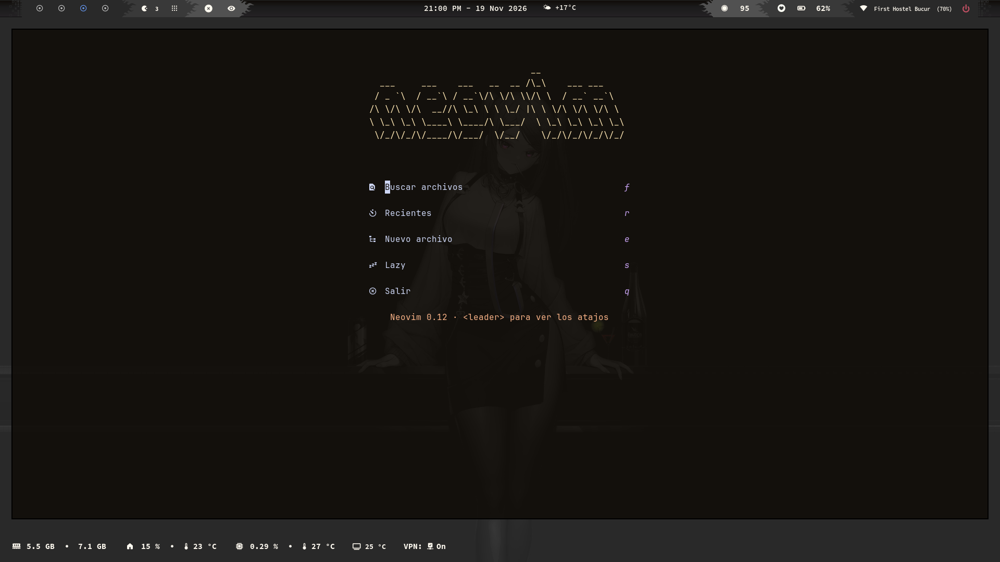
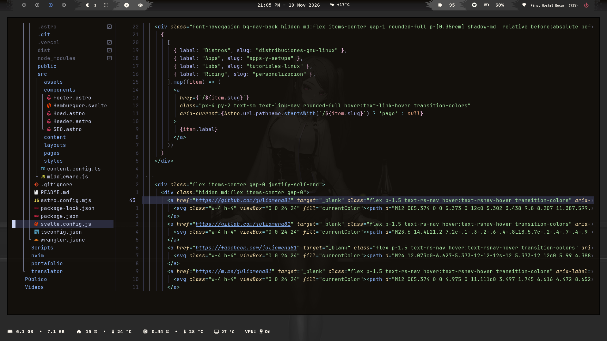
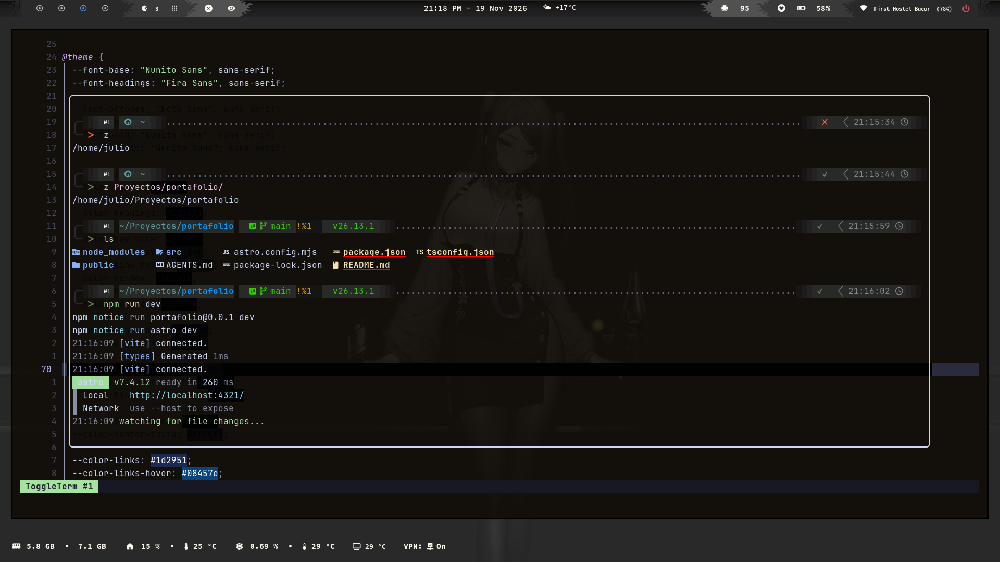

# Neovim 0.12 · Lua configuration for web, Python, and Markdown

[](https://neovim.io)
[](https://www.lua.org)
[](https://github.com/folke/lazy.nvim)
[](#licencia)

Personal configuration designed for working with **CSS, TailwindCSS, Astro, Svelte, Python, and Markdown**, featuring integrated Git, LSP, Treesitter, autocompletion, and automatic formatting.

All configuration is written in **Lua** with the Neovim 0.12 modern API: `vim.lsp.config`,`vim.lsp.enable`, `vim.treesitter.start`, `vim.diagnostic`, `vim.keymap.set` and
`vim.opt`.

- **Catppuccin Mocha** theme with a **toggleable transparent background** and **Lualine**.
- **fzf-lua** for searching, **neo-tree** for the file tree, and **toggleterm** for the terminal.
- **nvim-cmp + LuaSnip** for autocompletion and snippets.
- **Neogit + Diffview + gitsigns** for Git operations without leaving the editor.
- **Mason** for installing servers and tools; **conform** for formatting on save.
- Cold start time ~100 ms; all resource-intensive components are loaded lazily—triggered by specific events, commands, or keybindings.

> Tested on Neovim 0.12.6 on Arch Linux. The configuration is portable to
> any Linux/macOS; Arch installation commands are just one example.

### Screenshots







---

## Features

| Area              | What's included                                                                     |
| ----------------- | ----------------------------------------------------------------------------------- |
| **Theme**         | Catppuccin Mocha, optional transparency, lualine with the official Catppuccin theme |
| **Navigation**    | fzf-lua (files, grep, buffers, symbols, diagnostics, git, help), neo-tree, Harpoon  |
| **LSP**           | Mason + `vim.lsp.config/enable`, float diagnostics, Trouble                         |
| **Autocomplete**  | nvim-cmp, LuaSnip, friendly-snippets, menu with icons and documentation             |
| **Syntax**        | Treesitter (`main`) with highlight, folds and textobjects                           |
| **Format**        | conform: stylua, ruff, prettier, shfmt; on save and on demand                       |
| **Lint**          | ruff (via LSP) + nvim-lint (shellcheck, hadolint)                                   |
| **Git**           | gitsigns, Neogit, Diffview                                                          |
| **Tests / debug** | neotest (Python, Jest/Vitest), nvim-dap + dap-ui + debugpy                          |
| **Markdown**      | marksman, render in buffer, preview in browser, corrector es/en                     |
| **Extras**        | opencode.nvim, alpha, snacks (notifier, indent, words), which-key                   |

---

## Requirements

| Dependency                   | Purpose                                                          |
| ---------------------------- | ---------------------------------------------------------------- |
| **Neovim ≥ 0.12**            | Modern API (`vim.lsp.config`, `vim.treesitter.start`)            |
| `git`, `curl`, `tar`         | `lazy.nvim` and downloading parsers                              |
| `gcc`, `make`                | Compiling parsers and LuaSnip’s `jsregexp`                       |
| **`tree-sitter-cli ≥ 0.26`** | `nvim-treesitter` parsers (`main` branch)                        |
| `nodejs`, `npm`              | pyright, astro, svelte, tailwind, ts, prettier, markdown-preview |
| `unzip`                      | Used by Mason to extract binaries                                |
| `ripgrep`, `fd`              | Grep and file searching                                          |
| `fzf`, `bat`                 | `fzf-lua` and previews                                           |
| `wl-clipboard`               | System clipboard integration (`clipboard=unnamedplus`)           |
| Nerd Font                    | Icons                                                            |

Example on Arch Linux:

```bash
sudo pacman -S --needed neovim git curl tar gcc make tree-sitter-cli \
  nodejs npm unzip ripgrep fd fzf bat wl-clipboard
```

Mason takes care of the rest: `lua_ls`, `pyright`, `ruff`, `ts_ls`, `cssls`,
`html`, `jsonls`, `yamlls`, `tailwindcss`, `astro`, `svelte`, `emmet_language_server`,
`marksman`, `bashls`, `dockerls`, `stylua`, `prettier`, `shfmt`, `shellcheck`,
`hadolint`, `debugpy`.

---

## Installation

```bash
# 1) Save your current settings (if you have one)
mv ~/.config/nvim ~/.config/nvim.bak

# 2) Clone this repository
git clone https://github.com/juliomena81/nvim.git ~/.config/nvim

# 3) Start Neovim: lazy.nvim installs itself
nvim
```

Upon the first startup, lazy downloads the plugins. Afterward:

```vim
:Mason        " check/install servers and tools
:TSUpdate     " compile any missing parsers
:checkhealth  " verify LSP, Treesitter, and Mason
```

For a reproducible installation, the repository includes `lazy-lock.json`:
`:Lazy restore` sets all plugins to their pinned versions.

---

## Layout

```
.
├── init.lua # leader, vim.g.transparent, load order
├── lazy-lock.json # pinned plugin versions
├── stylua.toml
├── spell/ # optional: en dictionaries (see below)
└── lua/usr/
├── lazy.lua # lazy.nvim bootstrap + imports
├── core/
│ ├── setup.lua # options, filetypes, PATH, :Cheatsheet, :Transparency
│ ├── autocmds.lua # yank, checkdirs, markdown, indentation, ColorScheme
│ ├── keymaps.lua # global shortcuts
│ └── transparency.lua # apply/restore backgrounds
└── plugins/
├── core/ # lsp, cmp, luasnip, format, lint, treesitter
├── ui/ # catppuccin, lualine, alpha, snacks, trouble, which-key
├── git/ # gitsigns, diffview, neogit
├── navigation/ # fzf, neo-tree, harpoon
├── testing/ # neotest, nvim-dap
├── web/ # colorizer, autotag, surround, tailwind-colorizer
├── utils/ # markdown-preview, render-markdown, toggleterm
└── extras/ # opencode
```

The `usr` namespace avoids collisions with plugin modules: everything proper is
`require('usr...')`.

### Design decisions

- **One tool per function**: snacks provides notifier/indent/words, but the
  picker is fzf-lua, tree is neo-tree and terminal is toggleterm.
- **Lazy loading**: specs use `event`, `cmd`, `keys` or `ft`; the boot
  does not block with plugins that are not used.
- **Native API**: LSP is configured with `vim.lsp.config` and enabled with
  `vim.lsp.enable`; Mason only installs binaries.
- **Centralized format** in conform; Astro's LSP formats `.astro` with its
  own Prettier + plugin.

---

## Languages

| Language       | LSP                                               | Formatting                  | Extras                            |
| -------------- | ------------------------------------------------- | --------------------------- | --------------------------------- |
| CSS / SCSS     | `cssls` (ignores `@tailwind`, `@apply`, `@theme`) | Prettier                    | Colorizer, Tailwind LSP           |
| Tailwind       | `tailwindcss` (Astro, JSX, CSS, Markdown)         | —                           | Colors in the completion menu     |
| Astro          | `astro` + `emmet_language_server`                 | Astro LSP                   | Autotag, Tree-sitter              |
| Svelte         | `svelte` + `emmet_language_server`                | Prettier                    | Autotag                           |
| HTML / JS / TS | `html`, `ts_ls`, `jsonls`, `yamlls`               | Prettier                    | Autotag, surround                 |
| Python         | `pyright` + `ruff` (detects `.venv`)              | Ruff (imports + formatting) | Neotest, debugpy                  |
| Markdown       | `marksman`                                        | Prettier                    | Rendering, preview, spell checker |
| Lua            | `lua_ls`                                          | StyLua                      | —                                 |
| Shell / Docker | `bashls`, `dockerls`                              | shfmt                       | ShellCheck, Hadolint              |

Astro and Svelte use the project's local TypeScript; if it is not found, they fall back to the version managed by Mason, and finally to the global npm installation.

---

## Shortcuts

`<leader>` is **Space**. Pressing it and waiting will cause `which-key` to display the available groups.
The complete reference can be found in [`CHEATSHEET.md`](CHEATSHEET.md), which can be opened using
`:Cheatsheet`.

| Shortcut                          | Action                                           |
| --------------------------------- | ------------------------------------------------ |
| `<leader>ff` / `fg` / `fw`        | files / grep / word under cursor                 |
| `<leader>e` / `E`                 | neo-tree / reveal file                           |
| `<leader>fb` / `fr` / `fd`        | buffers / recent files / diagnostics             |
| `gd` `gr` `K`                     | definition / references / documentation          |
| `<leader>ca` / `cr` / `cf`        | code actions / rename / format                   |
| `<leader>gg` / `gc` / `gd`        | Neogit / commit / Diffview                       |
| `<leader>gs` / `gr` / `gp` / `gn` | stage / reset / previous hunk / next hunk        |
| `<leader>tt` / `tf` / `to`        | test (nearest) / test (file) / test (output)     |
| `<leader>du` / `dc` / `db`        | DAP UI / continue / breakpoint                   |
| `<leader>mp` / `mr`               | preview Markdown (in browser) / render in buffer |
| `Ctrl+t`                          | floating terminal (or `:Term`)                   |
| `<leader>ut`                      | toggle transparent background                    |
| `<leader>?`                       | shortcuts for the current buffer                 |

---

## Transparent background

The theme starts **transparent**, but only the background of the editor: the bar
state remains solid so that it can be read well.

- `:Transparency` or `<leader>ut` toggle transparent/solid hot.
- `vim.g.transparent = false` in `init.lua` makes it boot opaque.
- Transparency is applied by `usr/core/transparency.lua`: saves colors
  'Normal' originals, floats, neo-tree, fzf-lua, snacks, Trouble, which-key
  and Mason, and restores them upon deactivation.
- Lualine does not define theme: use `theme = 'auto'` and Catppuccin exposes
  `catppuccin-mocha` (the name of the colorscheme), so it inherits the colors
  automatically.

You need **your terminal** to have a transparent background (for example
`background_opacity` in Alacritty/kitty/wezterm).

---

## Spell checker (Spanish)

Optional. Triggers only on **Markdown, `gitcommit`, text and asciidoc**, never
in code.

```bash
mkdir -p ~/.config/nvim/spell
curl -fLo ~/.config/nvim/spell/es.utf-8.spl \
  https://ftp.nluug.nl/pub/vim/runtime/spell/es.utf-8.spl
curl -fLo ~/.config/nvim/spell/es.utf-8.sug \
  https://ftp.nluug.nl/pub/vim/runtime/spell/es.utf-8.sug
```

With the `.spl` present, `spelllang` = `es,en` (Spanish first); if not, `en`.

| Key          | Action                                 |
| ------------ | -------------------------------------- |
| `]s` / `[s`  | next/previous missing                  |
| `z=`         | suggestions                            |
| `zg` / `2zg` | add word to Spanish/English dictionary |
| `zw` / `zug` | mark incorrect/undo                    |

`zg` writes to `spell/es.utf-8.add` and Neovim compiles `*.add.spl` separately:
Official dictionaries are never overwritten.

> If you don't want to version the dictionaries (2.5 MB), add `spell/` to
> `.gitignore`.

---

## Maintenance

| Command                      | Action                 |
| ---------------------------- | ---------------------- |
| `<leader>l` / `:Lazy`        | plugin status          |
| `:Lazy sync` / `:Lazy clean` | install/clean          |
| `:Mason`                     | servers and tools      |
| `:TSUpdate`                  | parsers                |
| `:ConformInfo`               | buffer formatters      |
| `:checkhealth`               | diagnosis              |
| `:Transparency`              | transparent background |
| `:Cheatsheet`                | shortcut reference     |

Normal notices in `:checkhealth`: `lazygit` (disabled), tools
optional images/PDF/Mermaid (snacks.image off) and lockfile
`vim.pack` (not used, the manager is lazy.nvim).

---

## Customization

| What                           | Where                                                   |
| ------------------------------ | ------------------------------------------------------- |
| Leader                         | `init.lua` → `vim.g.mapleader`                          |
| Catppuccin Flavors             | `lua/usr/plugins/ui/catppuccin.lua` → `local flavour`   |
| Initial transparency           | `init.lua` → `vim.g.transparent`                        |
| Add an LSP server              | `lua/usr/plugins/core/lsp.lua` → table `servers`        |
| Add a parser                   | `lua/usr/plugins/core/treesitter.lua` → table `parsers` |
| Formatters                     | `lua/usr/plugins/core/format.lua` → `formatters_by_ft`  |
| Own shortcuts                  | `lua/usr/core/keymaps.lua` and the plugin spec          |
| Disable formatting when saving | `<leader>uf` or `vim.g.disable_autoformat = true`       |

---

## Common Issues

- **No syntax highlighting**: `tree-sitter-cli` is missing; run `:checkhealth` and
  `:TSUpdate`.
- **Mason fails to install anything**: `node`, `npm`, or `unzip` are missing.
- **Terminal doesn't open via a keybinding**: Use `Ctrl+t` or `:Term`; some
  key combinations are intercepted by the host terminal.
- **No Spanish suggestions appear**: `es.utf-8.sug` is missing.
- **Background is not transparent**: Your terminal does not have opacity configured.

---

## Credits

Built upon the work of [folke](https://github.com/folke) (lazy.nvim,
which-key, snacks, trouble),
[Catppuccin](https://github.com/catppuccin/nvim),
[nvim-lspconfig](https://github.com/neovim/nvim-lspconfig),
[nvim-treesitter](https://github.com/nvim-treesitter/nvim-treesitter),
[nvim-cmp](https://github.com/hrsh7th/nvim-cmp),
[fzf-lua](https://github.com/ibhagwan/fzf-lua),
[neo-tree](https://github.com/nvim-neo-tree/neo-tree.nvim),
[Neogit](https://github.com/NeogitOrg/neogit),
[conform](https://github.com/stevearc/conform.nvim), and the other authors
listed in `lazy-lock.json`.

Conventions inspired by the Neovim community (Kickstart, LazyVim).

## License

MIT. If you publish the repository, include the corresponding `LICENSE` file.
